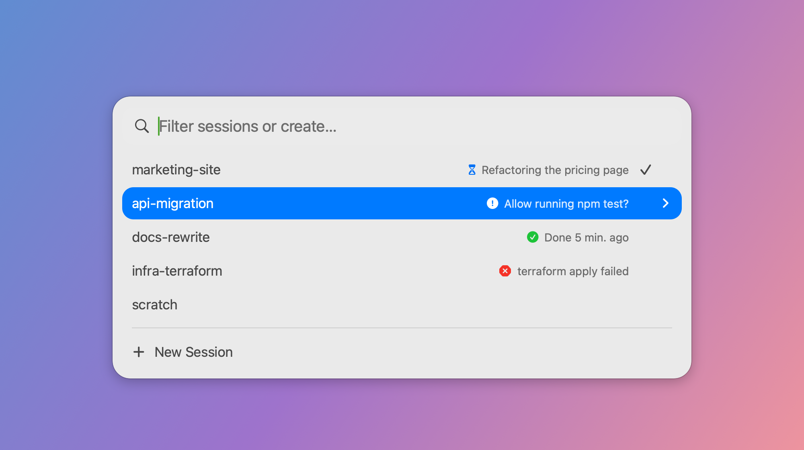
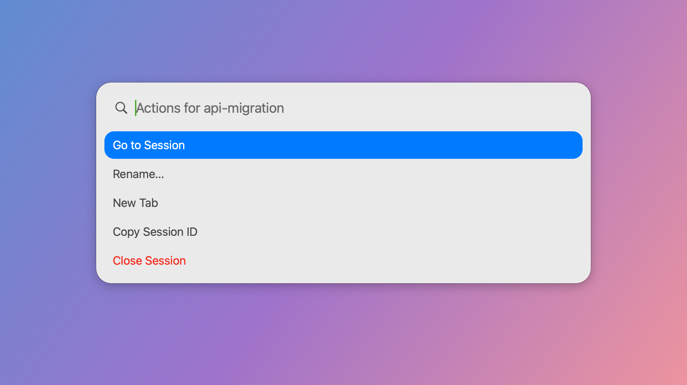
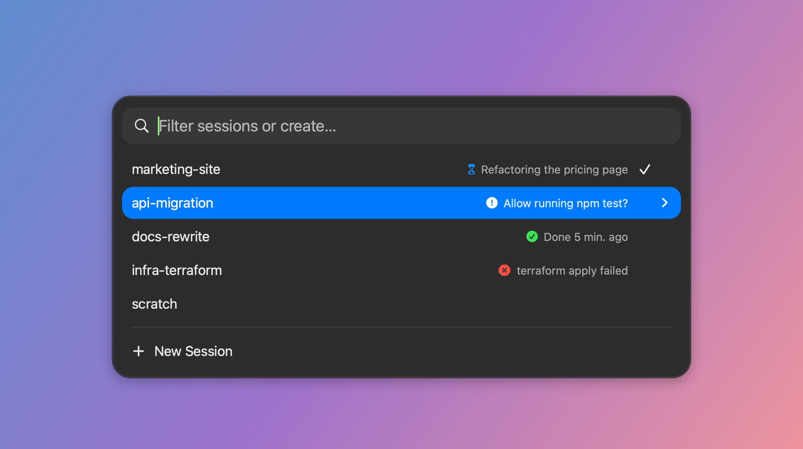

# Rex macOS Session Switcher





A native macOS popup for switching between [Rex](https://www.superlogical.com/rex/docs/) sessions. Press <kbd>⌘E</kbd>, type to filter, press <kbd>Return</kbd>. It is built with AppKit and looks like a system popover, in light or dark mode.

<details>
<summary>Dark mode</summary>



</details>

## Features

- **Agent status on every row.** Shows whether a coding agent in the session is working, waiting for you, done or failed, with the agent's own message. It reads the [program status](https://www.superlogical.com/rex/docs/build/program-status.md) that programs report to Rex, so any program that reports it shows up.
- **Most recently used first.** The popup opens on the session you were in before this one, like <kbd>⌘Tab</kbd>.
- **Session actions.** Press <kbd>Tab</kbd> (or <kbd>→</kbd>) on a session to rename it, open a new tab in it, copy its ID or close it. Closing asks for confirmation first.
- **Create sessions.** Type a name and pick **New Session** to create one with a shell tab and switch to it.
- **Placed over Rex.** The popup appears centered near the top of Rex's window.

## Requirements

- macOS with [Rex](https://www.superlogical.com/rex/docs/installation.md) installed. Tested with Rex Beta 0.1.0 (build 1993) on Apple Silicon.
- Swift, to build the helper: Xcode or the Command Line Tools (`xcode-select --install`).
- **Remote Control** turned on in Rex.app (Settings → Rex Server). Rex needs it to let the extension switch the app to another session.

## Install

```sh
git clone https://github.com/pantulis/rex-macos-session-switcher.git
cd rex-macos-session-switcher
make install   # builds the helper and copies it into Rex's config directory
make enable    # adds one line to init.lua and reloads Rex's configuration
```

Rex.app keeps its own copy of the key bindings, so also run this once, using your client's label or ID from `rex client ls`:

```sh
rex -C <client> do client.config.reload
```

Then press <kbd>⌘E</kbd>.

If you'd rather edit `init.lua` yourself, `make install` is enough, and you add this line (the path is where `make install` put the files):

```lua
dofile(os.getenv("HOME") .. "/.config/rex/rex-macos-session-switcher/session-switcher.lua")
```

Files go to `$REX_CONFIG`'s directory if set, else `$XDG_CONFIG_HOME/rex`, else `~/.config/rex`.

## Keys

| Key | In the session list | In the actions menu |
| --- | --- | --- |
| <kbd>↑</kbd> <kbd>↓</kbd> | Move the selection | Move the selection |
| <kbd>Return</kbd> | Go to the session (or create one) | Run the action |
| <kbd>Tab</kbd> or <kbd>→</kbd> | Open the session's actions | Back to the list |
| <kbd>Shift</kbd>+<kbd>Tab</kbd> or <kbd>←</kbd> | | Back to the list |
| <kbd>Esc</kbd> | Close the popup | Back to the list |
| Typing | Filters sessions | Filters actions |

<kbd>←</kbd> and <kbd>→</kbd> only change menus when the filter field is empty. Otherwise they move the text cursor. Clicking outside the popup closes it.

## Configuration

The popup is bound to <kbd>⌘E</kbd> by default. To use another key, or none, set an option **before** the `dofile` line in `init.lua`:

```lua
rex_macos_session_switcher = { bind = "cmd+shift+e" }  -- a different key
-- rex_macos_session_switcher = { bind = false }       -- no key binding
dofile(os.getenv("HOME") .. "/.config/rex/rex-macos-session-switcher/session-switcher.lua")
```

The extension defines an action called `switch_session` ("Switch Session (Native)" in the command palette), so you can also bind it yourself:

```lua
rex.bind("ctrl+space", "switch_session")
```

Run `rex config reload` and `rex -C <client> do client.config.reload` after changing `init.lua`.

By default the popup is placed over Rex's window. Set `REX_SWITCHER_POSITION=screen` in the environment of the Rex server to center it on the screen instead.

## How it works

`session-switcher.lua` defines a Rex [custom action](https://www.superlogical.com/rex/docs/customize/actions.md). When it runs it lists the sessions, reads each session's program status, and pipes them as JSON to `rex-session-switcher`, a small AppKit program built from `switcher.swift`. The helper shows the popup and prints the user's choice as JSON. The action then carries it out with Rex's API: `session.select`, `session.create`, `session.set_label`, `session.new_window` or `session.destroy`.

Rex doesn't report when a session was last used, so the extension keeps its own list of recently used sessions in `recent.txt` next to the helper. Only switches made through this popup are recorded.

## Troubleshooting

- **Nothing happens on <kbd>⌘E</kbd>.** Run `rex config check` and look for errors, then `rex -C <client> do client.config.reload`. Make sure `make install` ran, because the action logs a message if the helper is missing.
- **The popup opens but Rex doesn't switch.** Turn on Remote Control in Rex.app (Settings → Rex Server).
- **`swiftc not found`.** Install the Command Line Tools with `xcode-select --install`.
- **No agent status.** Only programs that report status to Rex using the OSC 7501 [program status](https://www.superlogical.com/rex/docs/build/program-status.md) sequence appear. Plain shells show nothing.

## Uninstall

```sh
make uninstall
```

Then remove the `dofile` line from `init.lua`.

## Development

```sh
make build                 # builds ./rex-session-switcher
echo '{"current":"a","sessions":[{"session_id":"a","label":"alpha"},{"session_id":"b","label":"beta"}]}' \
  | ./rex-session-switcher   # try the popup on its own
./tools/screenshots.sh     # regenerates docs/images with made-up sessions
```

The helper reads `{"sessions":[{"session_id","label","status"?}],"current"}` on standard input. It prints `{"action","session_id","label"?}` and exits 0 when the user chooses something, and exits 1 if they cancel.

Limitations: statuses are a snapshot taken when the popup opens, and the list is not refreshed while it is open.

## License

[MIT](LICENSE)
